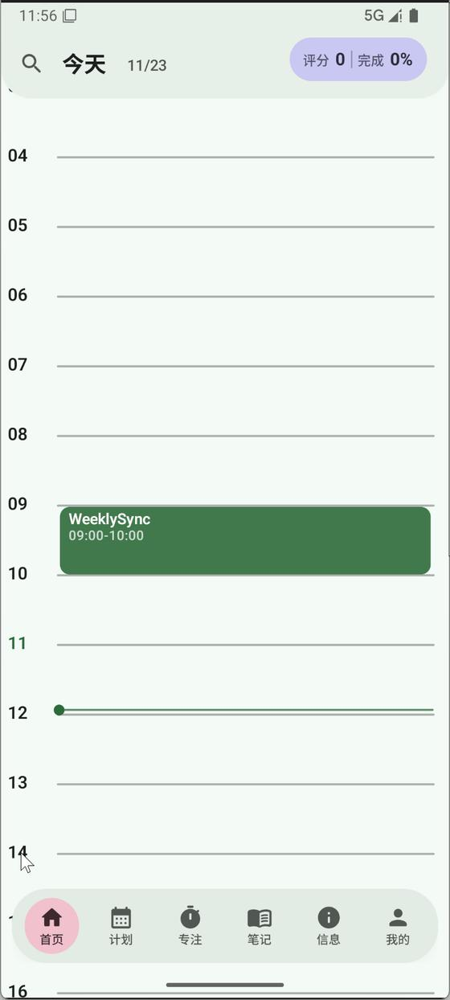
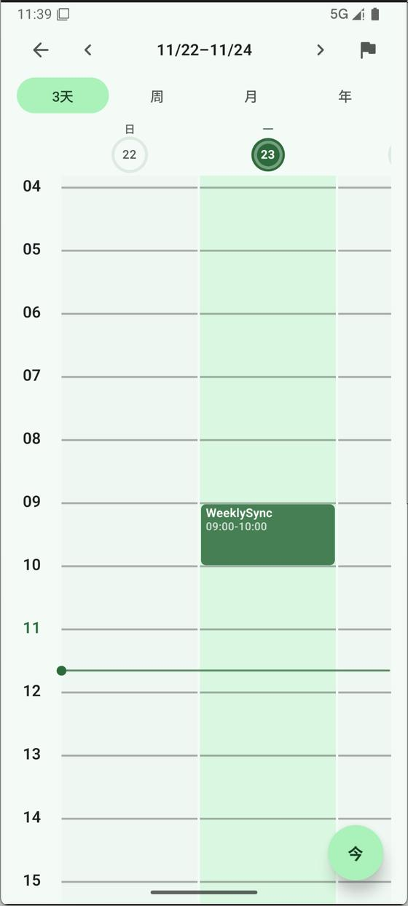
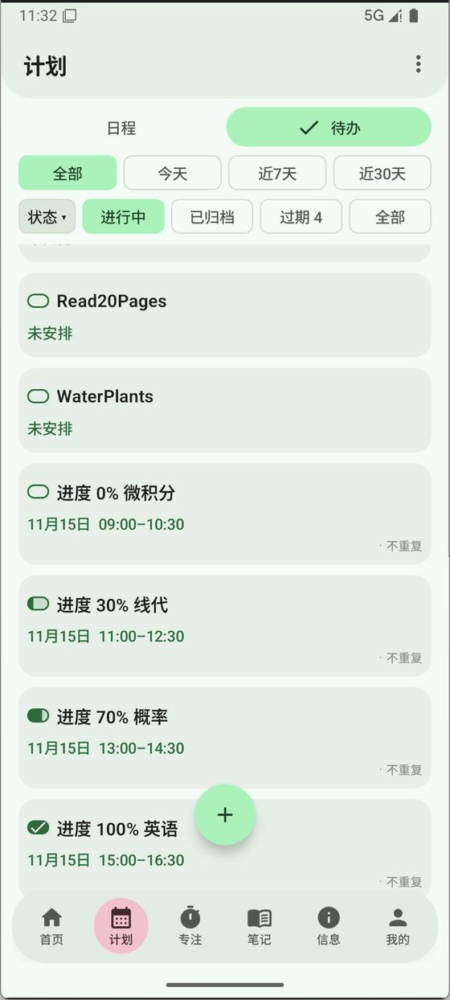
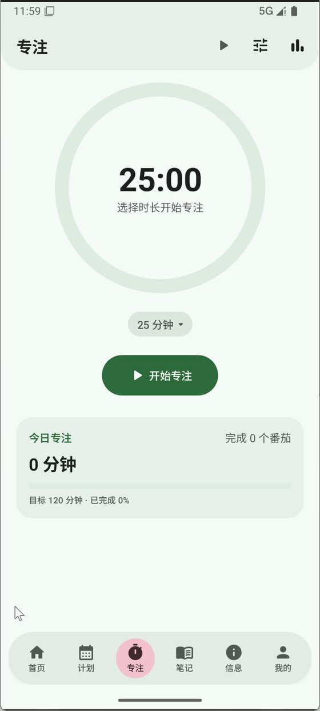
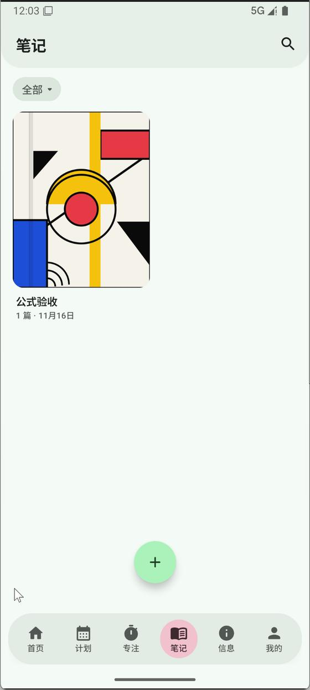
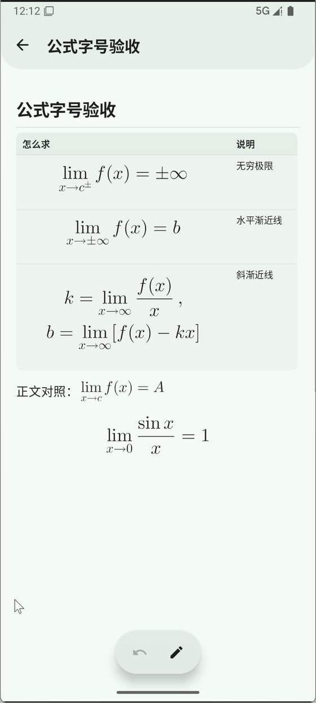
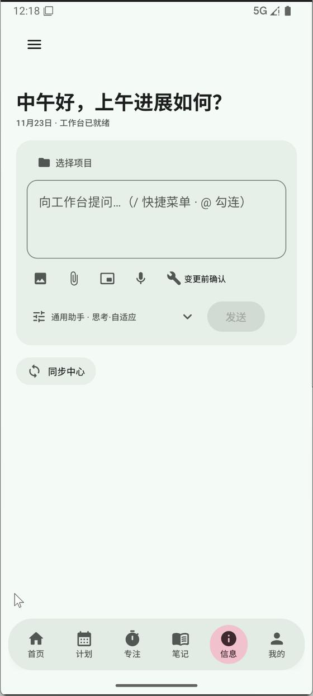
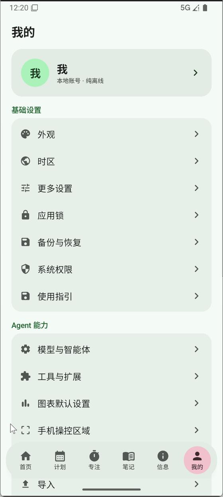

# Planability

A **local-first personal life workbench** for Android phones/tablets and desktop:
schedules, todos, notes-as-knowledge-base, focus timer, file hub, and an AI
assistant — all in one data model, with on-device SQLite as the single source
of truth. The AI is a *tool caller* with a risk-tiered tool face and a
human-review draft gate; it never writes real data directly.

> Current release: **1.0.0** · Platform: Kotlin 2.2 / Jetpack Compose (Android),
> Electron + React + TypeScript (desktop)

> **AI-generated code:** all code in this repository was generated by AI coding
> agents (large language models) under human direction and review. It is
> published as-is, without warranty of any kind — review before relying on it.

---

## Highlights

### AI workbench
- Multi-session chat with five thinking levels (off / adaptive / low / high / max),
  streaming, stop & regenerate, context compaction with per-turn restore
- **Tool face**: the assistant reads/writes schedules, todos, notes, memory,
  files and screen-time through function calls — every tool is risk-tiered
  (`AUTO` / `CONFIRM` / `DANGER`), and every write lands as a **draft in an
  assistant inbox** that a human reviews before it enters the real database
- **Layered memory**: scene summaries / persona / atomic memory entries with
  evidence links, semantic + dual-path FTS retrieval fused with RRF,
  and *invalidation instead of deletion* (`valid_at` / `invalid_at`)
- Pluggable OpenAI-compatible providers, plus **on-device models** on
  Snapdragon NPU (Qualcomm GenieX) and ONNX embedding models
- Character-card persona system (macro expansion, speech-quirk blocklist, seed greetings)

### Planning
- Two models: schedules (must have start/end time) and todos (may be untimed);
  recurrence rules are a cross-platform contract shared with the desktop client
- Calendar with 3-day / week / month views; 3-day and week views support
  **drag-to-reschedule** (15-minute snapping, cross-day, recurring items locked)
- Home timeline, today overview, weekly report & achievements

### Notes = knowledge base
- Markdown notes with `[[wikilink]]` backlinks and tag entry points
- Full-text search (`notes_fts`) + vector semantic search (two model tiers,
  downloaded on demand), fused with lexical results
- "Ask the knowledge base" multi-turn RAG that **explicitly refuses** when
  evidence coverage is too low, and returns an evidence pack instead of prose
- LaTeX rendering (jlatexmath) with dedicated CJK handling

### Focus / files / widgets
- Focus timer (pomodoro, presets, overview board), cross-device settings sync
- File hub: local folders as source of truth, Syncthing sync, readers for
  docx / xlsx / pptx / legacy ppt / pdf / image OCR, bilingual document reader
- Four home-screen widgets: today timeline, today stats, multi-day overview,
  screen-time breakdown

### Tablet & desktop
- Adaptive layout with width breakpoints and a reusable **two-pane
  `SplitBoard`** skeleton used by chat, plans, notes, files, memory and more
- Desktop client (`desktop/`) shares the same contracts: tool list, dump
  collections and the memory format are kept in sync by guard tests

---

## Screenshots

| Today (home) | 3-day calendar | Todos with progress |
|---|---|---|
|  |  |  |

| Focus timer | Notes | LaTeX rendering |
|---|---|---|
|  |  |  |

| AI workbench | Profile |
|---|---|
|  |  |

*Captured on an Android emulator with placeholder demo data.*

---

## Architecture in one screen

```
app/                     Android client (Kotlin · Compose · Room/SQLite)
  ai/                    model access, tool definitions, routing, context engineering
  core/                  windowing, theming, haptics, permissions, shell chrome
  data/                  Room entities, DAOs, repositories, backup
  ui/                    home (plans/calendar) · notes · info (chat/workbench) · focus · files · profile
desktop/                 desktop client (Electron · React · TS; contracts in shared/)
tools/device-guard/      device install guard (snapshot/restore; refuses non-debuggable builds)
docs/                    architecture notes and design decision records
```

Three invariants hold across the whole codebase:

1. **Disk/SQLite is the only source of truth.** Every mirror (exported
   markdown, desktop caches) is derived and rebuildable.
2. **AI never mutates real data directly.** Outputs land as inbox drafts;
   `PendingImporter` is the single ingestion channel.
3. **UI changes are verified on real devices** (screenshot/UI-dump), and
   source-structure guard tests pin key layout and contract decisions —
   reverting them turns tests red.

See [docs/architecture.md](docs/architecture.md) for details and
[docs/decisions/](docs/decisions/) for design decision records.

---

## Building

Prerequisites:
- JDK 21 (Android Studio's bundled JBR works)
- Android SDK (compileSdk 36)
- The Android client targets `arm64-v8a` devices

```bash
# Android client
./gradlew.bat :app:assembleDebug
# Unit tests (~1,800)
./gradlew.bat :app:testDebugUnitTest

# Desktop client
cd desktop && npm install && npm run dev
```

`local.properties` (SDK path), keystores, databases and build outputs are not
committed.

---

## Data & privacy

- All personal data stays on-device; no cloud accounts, no telemetry
- On every background transition the app snapshots the whole database to
  `Download/Planability/`, encrypted with AES-256-GCM (key in Android Keystore)
- `tools/device-guard/` provides full PC-side snapshots and restore; installs
  go through the guard, which refuses non-debuggable builds and blocks
  connected-AndroidTest targets pointing at a daily-driver device

---

## Project status

- `1.0.x`: bug fixes and small improvements only; new features go to `1.1+`
- The desktop client is still catching up with the mobile tool face
- On-device models depend on device NPUs (Snapdragon 8 Elite class) and are
  optional, not required
- Code comments are predominantly Chinese; user-facing docs are English
- **The app UI is Chinese (zh-CN) only.** In-app strings are not yet
  externalized; English currently covers only launcher/widget strings via
  `values-en`. See [docs/i18n.md](docs/i18n.md) for the current state and how
  to contribute a localization

## License

Released under the [GNU GPL-3.0](LICENSE). Third-party components and
fonts are covered by their own licenses — see
[THIRD-PARTY-NOTICES.md](THIRD-PARTY-NOTICES.md).

Maintained by [@m0use001](https://github.com/m0use001).
